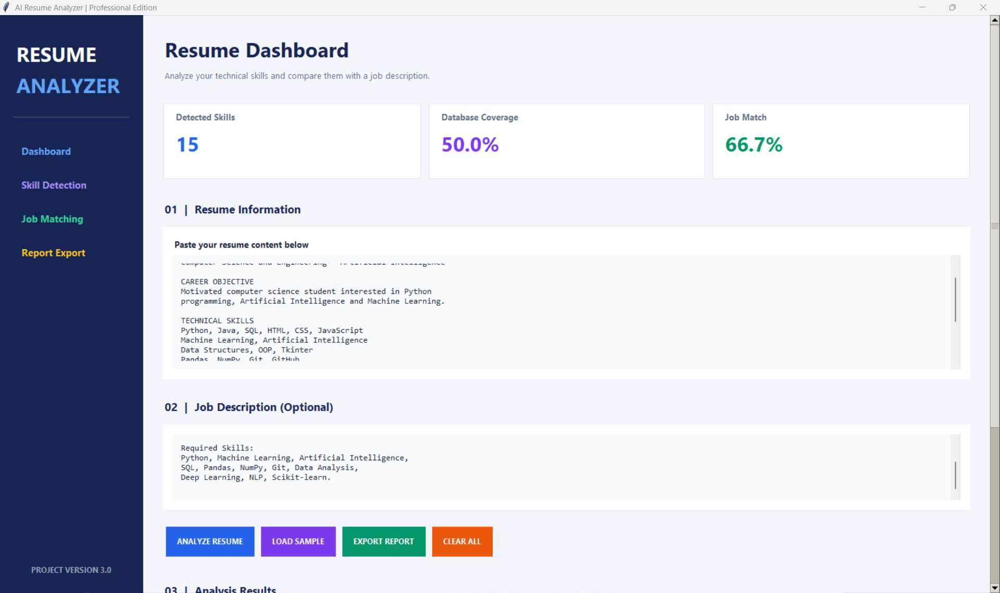
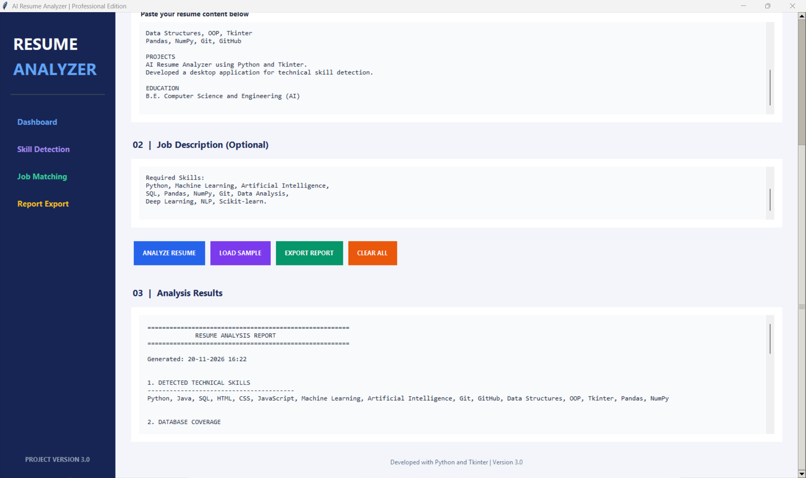

# 🚀 AI Resume Analyzer

A Python-based desktop application that analyzes resume content, identifies technical skills, and compares them with a target job description using keyword-based matching.

## 🖥️ Application Preview

### Main Dashboard


### Resume Analysis Results


## ✨ Features

- 🎨 Modern and colourful Tkinter GUI
- 🔍 Automatic technical skill detection
- 📊 Resume skill database coverage
- 🎯 Job description skill matching
- 💡 Missing skill identification
- 📄 Export analysis reports as TXT files
- 📝 Sample resume and job description
- 🧹 Clear and reset functionality

## 🛠️ Technologies Used

| Technology | Purpose |
|---|---|
| Python 3 | Core programming |
| Tkinter | Desktop GUI |
| Regular Expressions | Skill detection |
| datetime | Report timestamps |

**Dependencies:** Python standard library only. No external packages required.

## 📚 Supported Skills

Python, Java, C, C++, SQL, HTML, CSS, JavaScript, Machine Learning, Deep Learning, Artificial Intelligence, Git, GitHub, Django, Flask, Data Structures, OOP, Tkinter, Pandas, NumPy, Data Analysis, NLP, Scikit-learn, TensorFlow, PyTorch, REST API, MongoDB, MySQL, PostgreSQL and Linux.

## ⚙️ Installation and Execution

### 1. Clone the repository

```bash
git clone https://github.com/nithin00733/AI-Resume-Analyzer.git
```

### 2. Open the project folder

```bash
cd AI-Resume-Analyzer
```

### 3. Run the application

```bash
python ai.py
```

## 📊 How It Works

1. Enter your resume content.
2. Optionally enter a target job description.
3. Click **Analyze Resume**.
4. View detected skills and database coverage.
5. Check the job description match and missing skills.
6. Export your analysis report.

## 🧮 Analysis Metrics

- **Detected Skills:** Number of supported skills found in the resume.
- **Database Coverage:** Percentage of the application's supported skill database detected.
- **Job Match:** Percentage of supported job-description skills also detected in the resume.

> Note: This application uses rule-based keyword matching, not a trained AI model. The metrics are indicators of keyword presence, not actual skill proficiency or overall resume quality.

## 🔮 Future Enhancements

- PDF and DOCX resume extraction
- Context-aware NLP-based skill identification
- Expanded technical skill database
- Improved resume feedback
- Advanced job-role recommendations

## 👨‍💻 Developed By

**Nithin R.**

B.E. Computer Science and Engineering (Artificial Intelligence)  
Sathyabama Institute of Science and Technology

- GitHub: [nithin00733](https://github.com/nithin00733)
- Project: [AI Resume Analyzer](https://github.com/nithin00733/AI-Resume-Analyzer)

---

⭐ If you find this project useful, consider giving the repository a star!
